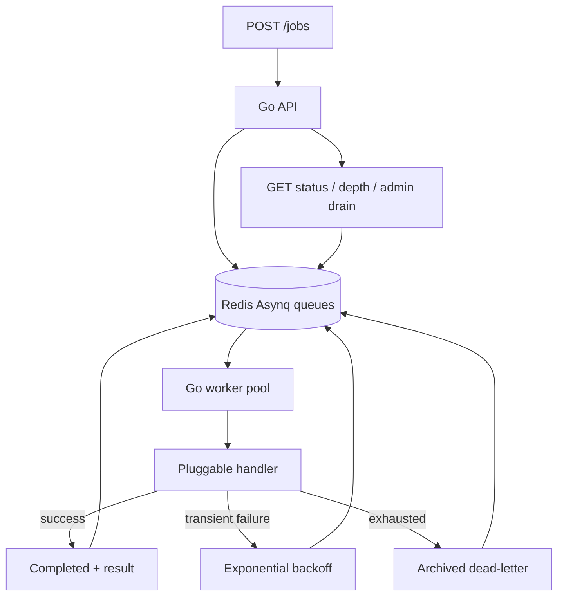

# Go Asynchronous Jobs API

An interview-scale Go REST API with Redis/Asynq workers, priority classes, exponential retries, per-attempt timeouts, archived dead-letter tasks, retained results, status/queue-depth endpoints, and drain/resume controls.

## Quick start

```bash
docker compose up --build -d --scale worker=2
curl http://localhost:8080/healthz
```

Submit a job:

```bash
curl -i -X POST http://localhost:8080/jobs -H 'Content-Type: application/json' -d '{"type":"demo.sleep","payload":{"duration_ms":250,"fail_first":0},"priority":9,"max_retries":3,"timeout_seconds":5}'
```

Expect HTTP 202 with a `job_id`. Fetch status and result with `GET /jobs/{id}`. See `GET /queue/depth` for waiting, active, archived, and retained-completed counters.

Pause admission / resume using a bearer token:

```bash
curl -X POST http://localhost:8080/admin/drain -H 'Authorization: Bearer local-dev-token'
curl -X GET http://localhost:8080/admin/drain -H 'Authorization: Bearer local-dev-token'
curl -X POST http://localhost:8080/admin/resume -H 'Authorization: Bearer local-dev-token'
```

## Worker configuration
`REDIS_ADDR` points to Redis; `WORKER_CONCURRENCY` defaults to 5 (1–100). API uses `HTTP_ADDR` (default :8080) and `ADMIN_TOKEN`; absent token disables admin operations. Compose sets a local-development-only token — replace it outside localhost. Worker can scale independently: `docker compose up -d --scale worker=4`.

Priority must be 0–9, default 5. 0–3: low; 4–6: default; 7–9: critical. Weights 1:3:6 approximate fairness and **do not guarantee strict global priority ordering**. `max_retries` range 0–10 (default 3). `timeout_seconds` range 1–300 (default 30). Payload limit 16 KiB. Only the `demo.sleep` handler is installed in the demonstration.

## Tests

```bash
go mod tidy
go test -race ./...
# Start a separate disposable Redis on localhost:6380:
docker run -d --name redis-test -p 6380:6379 redis:7.4-alpine
REDIS_TEST_ADDR=127.0.0.1:6380 go test -race -tags=integration -count=1 ./...
go vet ./...
go build ./cmd/api ./cmd/worker
```

**Warning:** integration tests flush Redis database 14; only run against a disposable Redis. GitHub Actions provisions Redis and executes the full suite automatically.

## Architecture



## At-least-once processing
Successful enqueue provides a durable task only to the extent of Redis persistence/failover guarantees. Asynq redelivers unfinished tasks after recovery, so a worker crash may execute a handler more than once. A crash after external effects but before completion acknowledgment is the classic duplicate window. This project logs job IDs and attempt counts, but does not implement downstream external-side-effect deduplication. See `docs/ARCHITECTURE.md`.

## What breaks first under load?
Redis backlog and retained-result memory grow when arrivals exceed workers' completion throughput; bounded worker concurrency alone doesn't bound waiting jobs. Heavy retries worsen load; worker capacity, queue age, dead-letter rates, Redis memory/persistence latency, and job p95 should be monitored. Admission limits and strict dedupe are recommended hardening. See `docs/QUEUE_OPTIONS.md` and `docs/PLAN.md`.

## Implementation status
Required endpoints, handler, retry policy, integration test scenarios and CI workflow are included. Not yet verified against a live Redis environment in the authoring runtime. Known gaps: no process-kill test, no cross-process exactly-once guarantee, no strict atomic drain fence, finite result retention.

## Idempotency demonstration
Send `Idempotency-Key: order-123` with POST /jobs. Identical replays return the existing job ID (HTTP 200); changed job config with that key returns 409 while the task is retained. Submit `demo.effect` with `max_retries: 1` to exercise Redis atomic effect deduplication after an injected post-effect failure. See [docs/IDEMPOTENCY.md](docs/IDEMPOTENCY.md). This does not provide exactly-once guarantees for arbitrary external systems.
