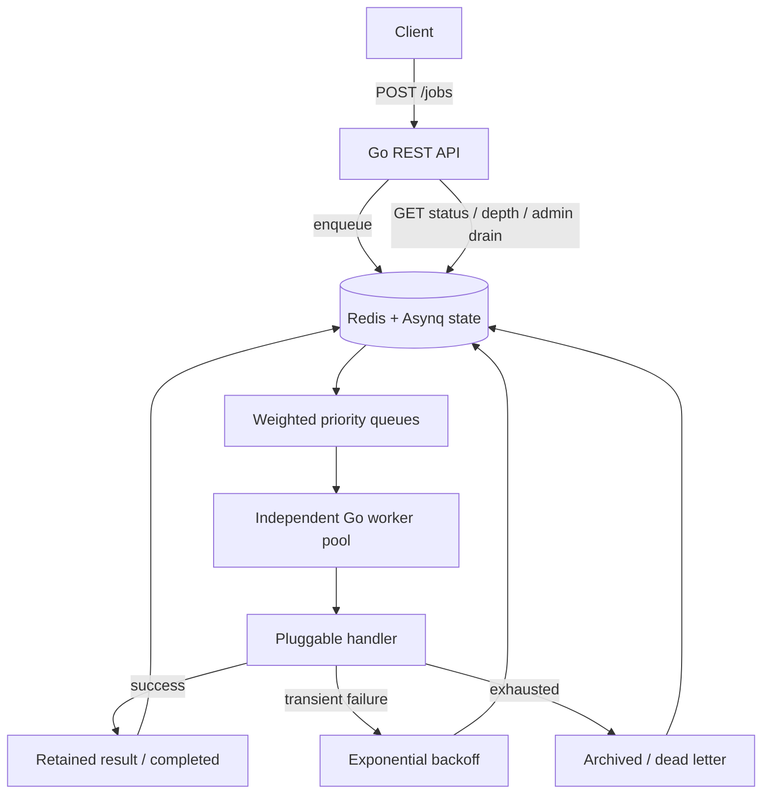

# Architecture and reliability

The Redis queue and retained job state are authoritative; there is no cross-database dual write. Worker concurrency is configured independently of the HTTP tier.

## Scheduling
Priority is an integer 0–9, validated at the API boundary. 0–3 maps to low (weight 1), 4–6 default (weight 3), 7–9 critical (weight 6). Weighted selection limits starvation across classes but cannot guarantee exact global numerical priority order, completion order or bounded waiting time.

## Delivery and duplicate execution
After a successful enqueue acknowledgment, Redis holds the task and Asynq supplies best-effort at-least-once processing through task recovery and retry. This is conditional on Redis persistence, queue availability, and retention. With AOF appendfsync everysec, a hard crash may lose the most recent acknowledged writes. Asynq can redeliver after a worker crash before its completion is recorded. A handler may have performed an external side effect already. Thus no exactly-once side-effect guarantee exists.

The example handler has no external side effects and logs job ID and retry count. For payments/emails, the downstream side-effect system must atomically dedupe a stable job ID and store a result before acknowledging. Logs detect repeated attempts but do not prevent side effects. The attempt count is derived from Asynq's retry state, not a permanent audit record.

## Draining
POST /admin/drain toggles a shared Redis gate so newly submitted jobs are refused. Already accepted tasks continue to completion. GET /admin/drain reports drained when both waiting and active are zero. The gate check and Redis enqueue are two operations, so concurrent in-flight submissions may pass between the check and drain; a strict admission fence requires a single atomic operation. POST /admin/resume reopens admission.

## What breaks first under load?
Sustained arrivals faster than processing cause Redis backlog growth and memory pressure. Limits on worker concurrency do not cap queue depth. Results and archived jobs also consume memory. Large task payloads worsen this. Backoff controls retry storms but does not reduce first-attempt arrival rates. Measure pending jobs, queue waiting time, oldest job age, worker utilization, Redis memory, Redis persistence latency, failed/archived count, and p95 job latency. At higher scale consider admission controls, more worker replicas, queue age limits, result archival to durable storage and queue-class capacity allocations.

## What isn't implemented yet?
No cron, DigitalOcean deployment, hard Redis backlog quota, atomic admission fencing, HTTP idempotency key, real worker process-kill recovery test, or durable external-side-effect deduplication.
